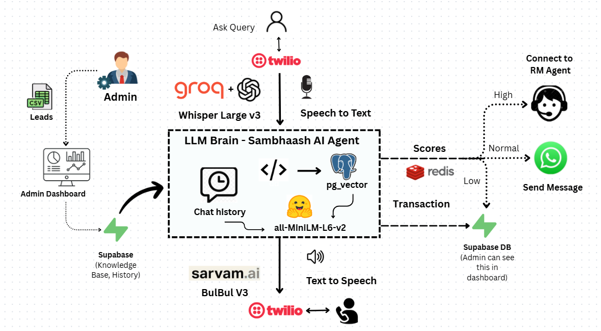
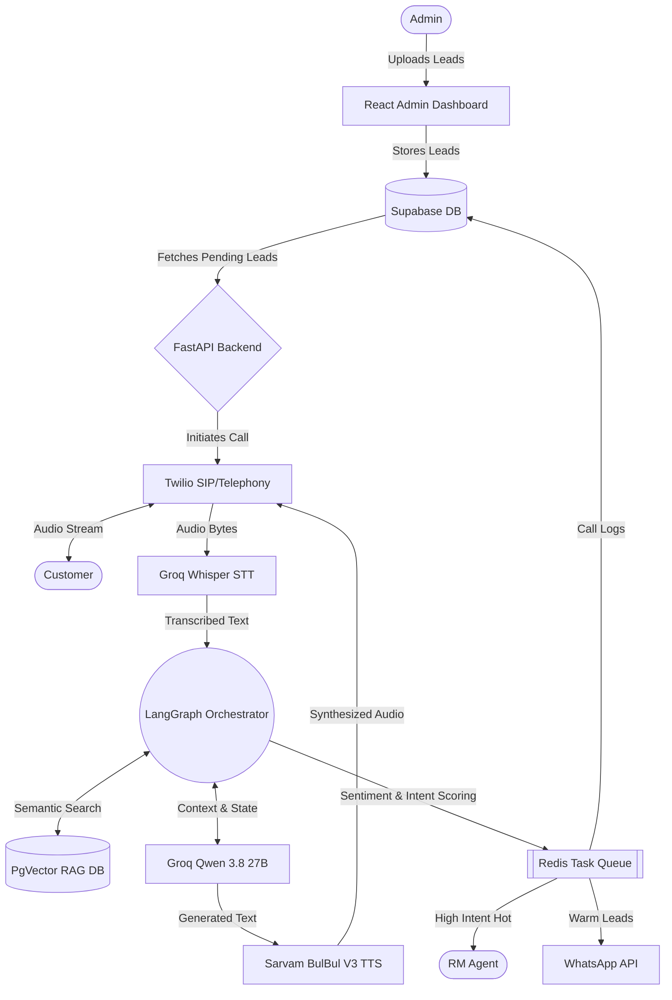
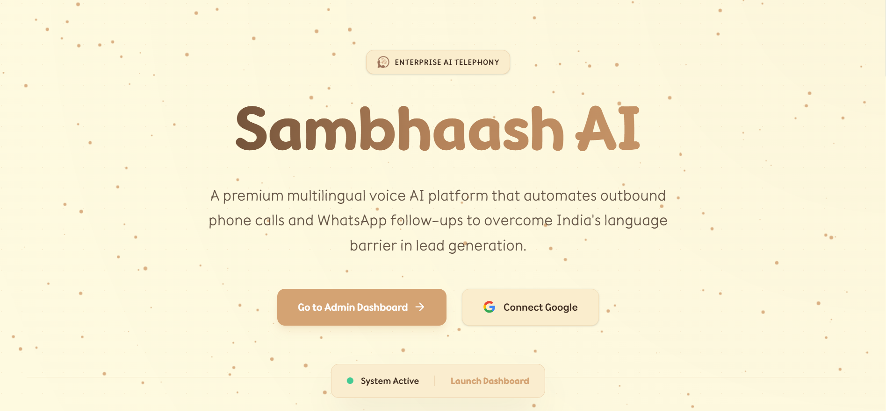
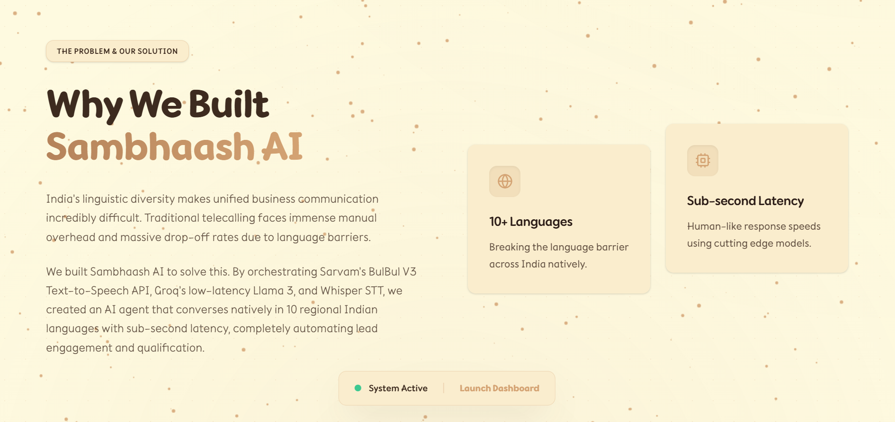
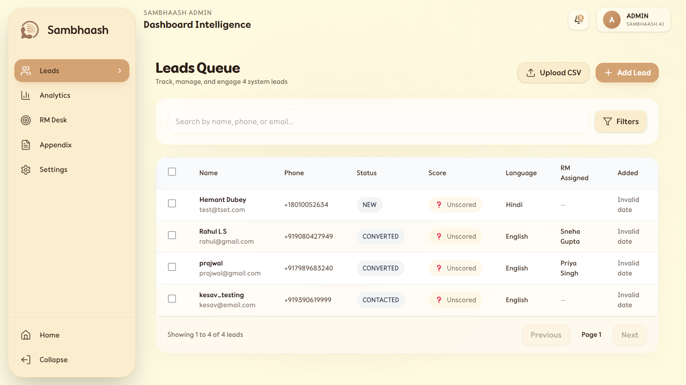
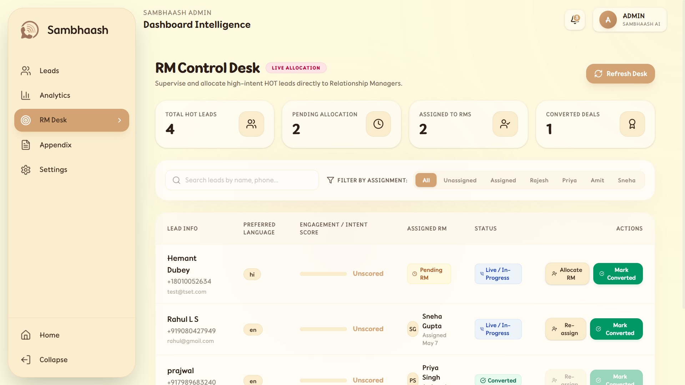

<div align="center">
  
  <h1>Sambhaash AI</h1>
  <p><strong>A Premium Multilingual Voice AI Platform for Automated Lead Generation</strong></p>
</div>

---

## Awards & Achievements

**Sambhaash AI is a winning project from the Namespace Hackathon!**
- 🥉 **3rd Place Globally (Sarvam AI Track):** Awarded $200 in Sarvam AI credits for building a high-fidelity conversational agent using BulBul V3.
- 🌍 **Top 50 Globally (Overall):** Recognized as a top 50 project worldwide, winning a $20 cash prize for excellence in the Work, Finance & Digital Economy theme.

---

## Overview

**Sambhaash AI** is an enterprise-grade multilingual voice AI platform designed to automate lead generation and overcome linguistic barriers in business outreach. Traditional telecalling operations suffer from massive manual overhead and high drop-off rates when agents cannot converse in a lead’s native tongue. 

To solve this, Sambhaash AI acts as an autonomous telephony orchestrator that seamlessly conducts outbound calls in 11 Indian languages, answering each turn in a couple of seconds, completely automating the initial engagement and qualification process. 

---

## Key Features

- **Multilingual Speech Engine:** English, Hindi and nine regional languages (Marathi, Bengali, Gujarati, Punjabi, Odia, Tamil, Telugu, Kannada, Malayalam) using Sarvam BulBul V3 for speech and Groq Whisper for transcription. The language spoken on the call is detected, remembered and used for the reply and the follow-up.
- **Dynamic RAG Knowledge Base:** Real-time semantic knowledge retrieval during live calls using local sentence-transformer embeddings and pgvector to handle complex client objections on the fly.
- **Lead Scoring & Routing:** Scores each call on intent, engagement and sentiment and classifies it HOT / WARM / COLD. HOT leads are assigned to a Relationship Manager queue on the dashboard; COLD leads are not re-dialled.
- **WhatsApp Follow-up Agent:** Sends WARM leads a follow-up in their own language and answers their replies with an LLM.
- **Unified Admin Dashboard:** A React command center to upload CSV leads, manage the knowledge base, review each call's transcript, score and summary, and work the RM queue.

---

## Architecture

The overall functional flow of Sambhaash AI covers the entire lifecycle—from the administrator uploading lead contacts to telephony engagement, RAG vector lookup, lead scoring, and intelligent handoffs.

<p align="center">
  
</p>



### How It Works (The Lifecycle)

1. **Lead Ingestion:** Administrators upload campaign lists via the React dashboard. Numbers are normalized to E.164 and leads are stored in **Supabase** with status `NEW`.
2. **Dialing:** A background worker picks up `NEW` leads and has **Twilio** place the call. Each caller utterance is recorded and posted to the backend, which answers with the next spoken reply (a record-and-respond loop, not a live audio stream).
3. **Transcription & Retrieval:** **Groq Whisper** transcribes the recording and the language is detected. The utterance is embedded locally and matched against the knowledge base to pull relevant chunks.
4. **Reasoning & Speech:** A **LangGraph** graph, given the call so far, picks a pitch / objection / knowledge-answer path and writes a short reply with a **Groq**-hosted LLM, which **Sarvam BulBul V3** synthesizes in the caller's language.
5. **Scoring & Follow-up:** When the caller gives a clear yes or no, or the call reaches its turn limit, the whole conversation is scored. **HOT** leads are assigned to a Relationship Manager's queue, **WARM** leads receive a WhatsApp follow-up in their language, and **COLD** leads are parked. A call summary is generated for every scored call.

---

## Tech Stack

### Frontend  
  

### Backend  
   

### Database  
   

### APIs & AI Models  
   

### Hosting & DevOps  
  

---

## Platform Previews

<div align="center">
  
  <br /><br />
  
  <br /><br />
  
  <br /><br />
  
</div>

---

## Local Setup

### Requirements:
- Node.js & npm
- Python 3.11 (matches the Dockerfile) & pip
- Docker (for Redis)
- API Keys: Supabase, Groq, Sarvam, Twilio, Ngrok

See [`Backend/README.md`](Backend/README.md) for configuration, safety notes and troubleshooting, and [`CODE_AUDIT.md`](CODE_AUDIT.md) for what is and is not implemented.

### Setup Instructions:
```bash
# 1. Frontend Setup
cd Frontend
cp .env.example .env # Configure environment variables
npm install
npm run dev

# 2. Backend Setup
cd ../Backend
python -m venv venv
source venv/bin/activate  # On Windows: venv\Scripts\activate
pip install -r requirements.txt
cp .env.example .env # Configure environment variables

# 3. Start Infrastructure & Workers
docker run -d --name sambhaash-redis -p 6379:6379 redis:alpine
python run_worker.py # Start dialer + job worker (it calls every NEW lead: see Backend/README.md)

# 4. Start Backend API (start this before the worker)
python -m uvicorn main:app --reload

# 5. Run the tests (no external services needed)
pytest
```

---

## Future Scope

- **Real RM allocation:** a roster, round-robin or workload-based assignment, RM notifications, a per-RM dashboard and a live call transfer for HOT leads.
- **More integrations:** Native integrations with standard CRM systems (Salesforce, HubSpot) to automatically update lead statuses and log call transcripts.
- **Security enhancements:** Enhanced access controls and PII redaction during LLM processing.
- **Localization / broader accessibility:** Expanding to international language models for global outreach and implementing custom voice branding/cloning.

---

## Contributors (Team TetraFourge)

- **Rahul L S** ([GitHub](https://github.com/Rahul-8283) | [LinkedIn](https://www.linkedin.com/in/rahul-ls))  
- **Kesav** ([GitHub](https://github.com/kesavvvvvv) | [LinkedIn](https://www.linkedin.com/in/kesav-satya-sai-nimmagadda-673164317))
- **Kabilan K** ([GitHub](https://github.com/KKabilan07) | [LinkedIn](https://www.linkedin.com/in/kabilank07/))
- **Prajwal Priyadarshan G** ([GitHub](https://github.com/prajwal-priyadarshan) | [LinkedIn](https://www.linkedin.com/in/prajwal-priyadarshan/))
- **Kishore B** ([GitHub](https://github.com/KishoreB25) | [LinkedIn](https://www.linkedin.com/in/kishore-b-245a66343))

---

<div align="center">
  <p>Built by Team TetraFourge for the Namespace Hackathon (Sarvam AI Track)</p>
</div>
